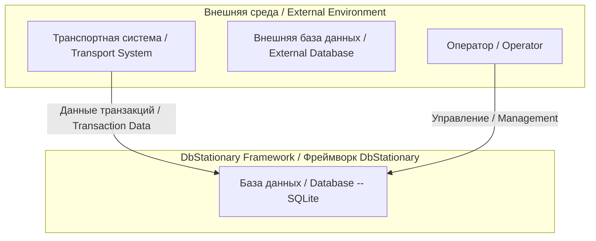
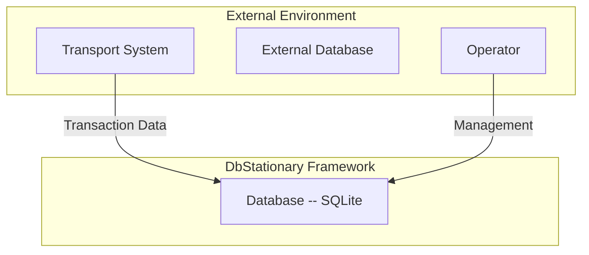
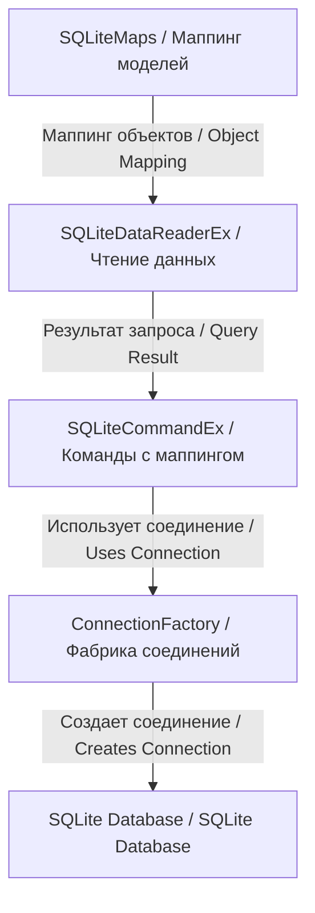
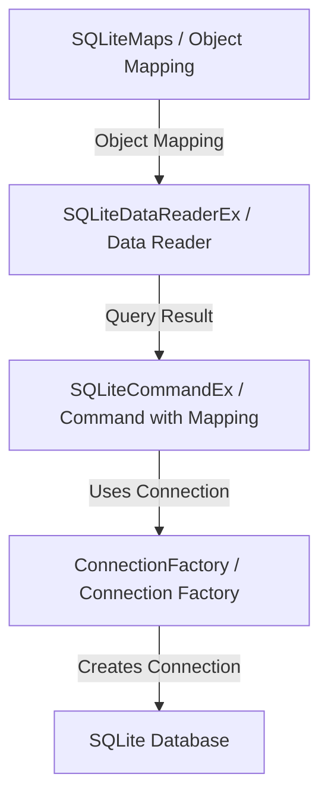

# DbStationary Architecture Overview / Обзор архитектуры DbStationary

**Repository:** `ekatmoz88-alt/dbstationary-architecture-docs`
**Source:** Extracted from `/home/kate/technical-docs-library/03_API/` and `/home/kate/deshifrator-docs/sources/DbStationary.Data/`
**Anonymization:** All real names, organization names, project ciphers, specific years, and internal connection strings replaced with placeholders.

---

## 1. Контекстная схема (C4 Context) / C4 Context Diagram

### RU
Показывает границы системы и внешних акторов.



### EN
Shows system boundaries and external actors.



---

## 2. Контейнерная схема (C4 Container) / C4 Container Diagram

### RU
Внутренняя структура фреймворка: компоненты и их взаимодействие.



### EN
Internal structure of the framework: components and their interaction.



---

## 3. Схема потоков данных / Data Flow Diagram

### RU
Показывает поток данных через компоненты при выполнении запроса.

```mermaid
flowchart TD
    Start([Запрос / Request]) --> CF[ConnectionFactory.GetConnection()]
    CF --> SC[SQLiteCommandEx.SetCommandText()]
    SC --> SR[SQLiteCommandEx.ExecuteReader()]
    SR --> DR[SQLiteDataReaderEx.Read()]
    DR --> MAP[SQLiteMaps.MapToObject()]
    MAP --> End([Результат / Result])

    style Start fill:#e1f5e1
    style End fill:#ffcccc
```

### EN
Shows data flow through components during query execution.

```mermaid
flowchart TD
    Start[Request] --> CF[ConnectionFactory.GetConnection()]
    CF --> SC[SQLiteCommandEx.SetCommandText()]
    SC --> SR[SQLiteCommandEx.ExecuteReader()]
    SR --> DR[SQLiteDataReaderEx.Read()]
    DR --> MAP[SQLiteMaps.MapToObject()]
    MAP --> End[Result]

    style Start fill:#e1f5e1
    style End fill:#ffcccc
```

---

## 4. Требования к структуре данных / Data Structure Requirements

### RU
Основные требования к хранению данных, взятые из технического задания.

| Параметр | Значение / Value |
|----------|-----------------|
| База данных | SQLite (встраиваемая БД) |
| Структура таблиц | Определяется в приложении № 3 к ТЗ |
| Индексы | Не менее 2 независимых внешних дисковых массива в горячем резерве |
| Резервное копирование | Физически отделено от места установки |

### EN
Data storage requirements from the technical specification.

| Parameter | Value |
|-----------|-------|
| Database | SQLite (embedded DB) |
| Table Structure | Defined in Application Appendix № 3 to TZ |
| Indexes | At least 2 independent external disk arrays in hot reserve |
| Backup | Physically separated from installation location |

---

## 5. Аннонимность / Anonymization Notice

Все реальные названия организаций, проектов, ФИО, годы и внутренние идентификаторы заменены на обобщённые обозначения. Документ подготовлен на основе извлечённых фактов без домыслов об отсутствующих параметрах.

---

## Ссылки на источники

- Требования: `/home/kate/technical-docs-library/03_API/Дискриптор-Требования.doc`
- Техническое задание: `/home/kate/technical-docs-library/03_API/тз.doc`
- Исходный код: `/home/kate/deshifrator-docs/sources/DbStationary.Data/`
- Діаграмма алгоритма: `/tmp/dbstationary_schemes/2009_03_26 Алгоритм ПО модуля MC24RT.png`

---
*Документ подготовлен на основе извлечённых фактов без домыслов отсутствующих параметров.*
*Document prepared based on extracted facts only, without guessing missing parameters.*